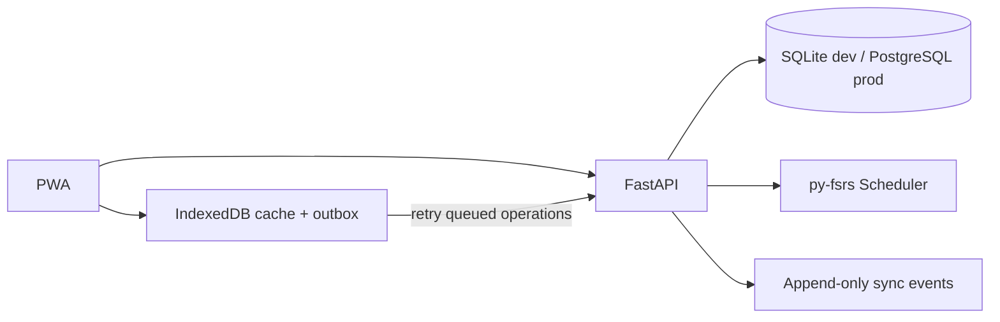

# Architecture

- Use UTC timestamps and ISO-8601 API values.
- Persist offline mutations to IndexedDB before acknowledging them as queued.
- UUID operation IDs make retry after a timeout idempotent.
- Reviews are append-only events; stale card versions return 409 rather than silently overwriting another device's review.
- Add authentication and per-user row isolation before public deployment.
- Use PostgreSQL and Alembic for production. Add HTTPS, rate limits, backups, and restore drills.
- Keep private PDFs and user content out of public Git.
